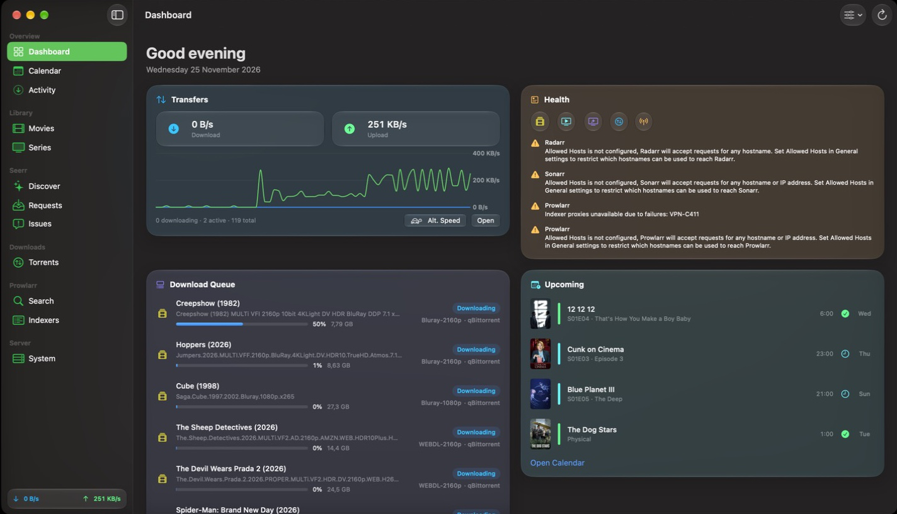
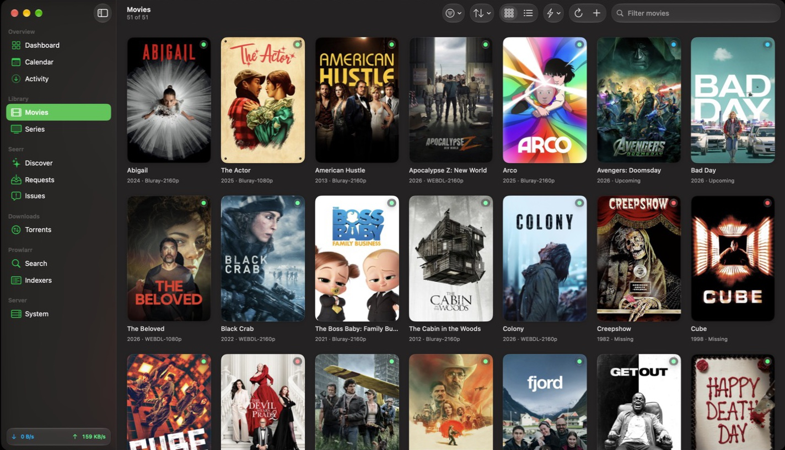
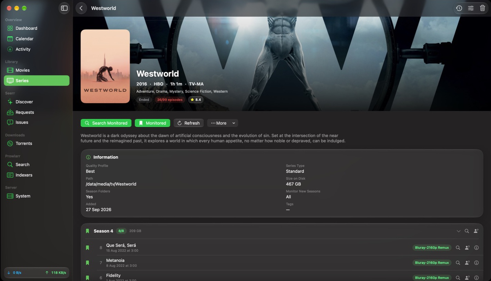
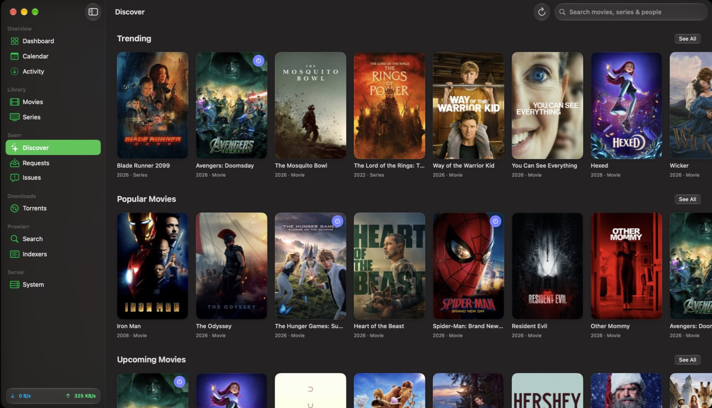
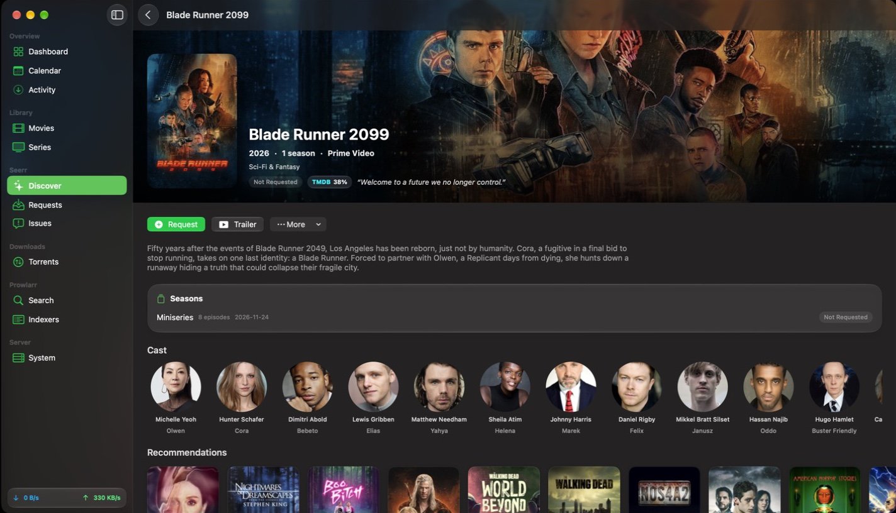
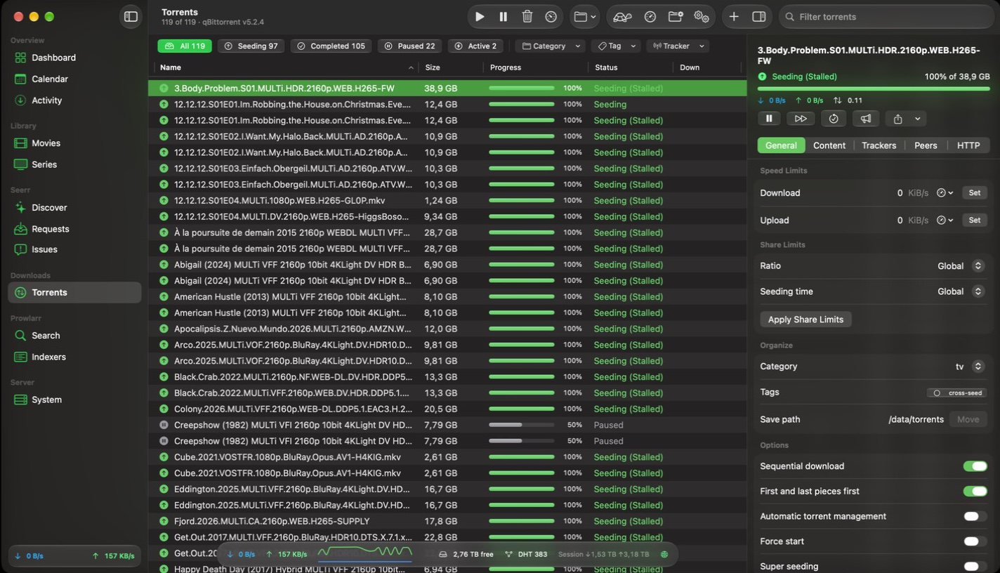
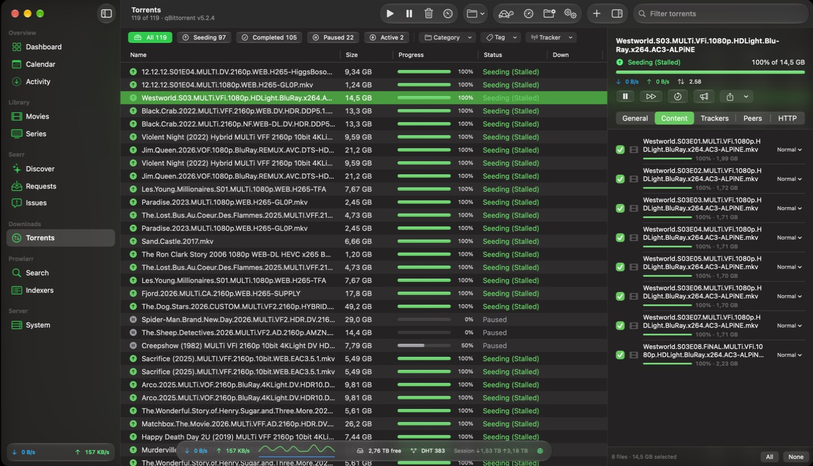
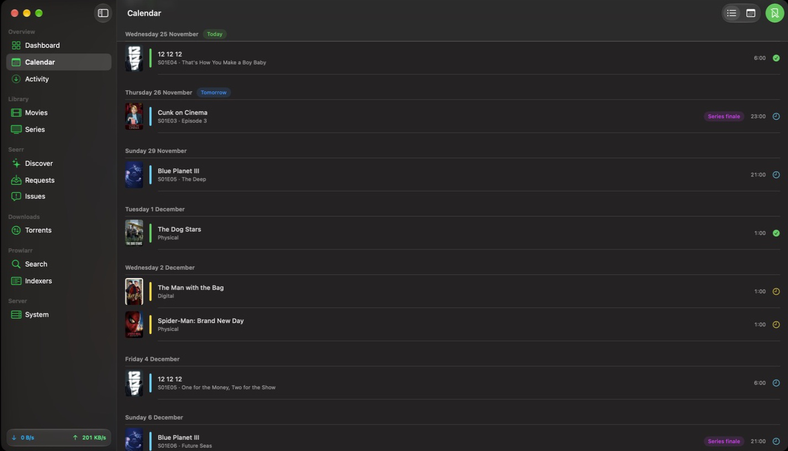

<p align="center">
  
</p>

<h1 align="center">Pilothouse</h1>

<p align="center">
  The native macOS control room for your home media stack —<br>
  <b>Radarr · Sonarr · Seerr · Prowlarr · qBittorrent</b><br>
  built with SwiftUI and Liquid Glass.
</p>

<p align="center">
  
  
  
</p>

<p align="center">
  
</p>

---

## Screenshots

| Movies | Series |
| --- | --- |
|  |  |

| Discover (Seerr) | Request details |
| --- | --- |
|  |  |

| Torrents — per-torrent controls | Torrents — files |
| --- | --- |
|  |  |

| Calendar |
| --- |
|  |

## Features

**Unlimited connections** — add as many Radarr, Sonarr, Seerr, Prowlarr and qBittorrent servers as you want (4K Radarr, a second seedbox…). Each section has a server switcher in the toolbar; Dashboard, Activity, Calendar and System combine every server.

**Find on Network** — scans your local network for each service on its usual ports, identifies what's running and, for Radarr, Sonarr and Prowlarr with local authentication disabled, fills in the API key for you. Every connection editor also has a **Detect** button and an API-key **Fetch** button.

**Dashboard** — live transfer speeds with a graph, health warnings from every server, the download queue, upcoming releases, pending requests, disk space and indexer stats. Cards can be shown, hidden and reset.

**Movies (Radarr)** — poster grid or sortable table, filters (missing, upcoming, cutoff unmet…), detail pages with backdrop, ratings, media info and history; automatic and interactive search with release grabbing, monitoring, edit (profile, availability, path, tags), refresh, rename, delete, and adding movies with every option.

**Series (Sonarr)** — the same library views plus seasons and episodes with per-season and per-episode monitoring, season or episode search (automatic or interactive), episode details with file info and history, and adding series with monitor options.

**Seerr** — Discover carousels and search, media pages with cast, trailer and recommendations, requests with season selection, 4K, server, profile and root folder, a request list with approve / decline / retry / delete, and issues with comments.

**Torrents (qBittorrent)** — everything you'd do in qBittorrent itself:
- live list using qBittorrent's incremental sync, a customizable 21-column table, filters by state, category, tag and tracker
- per-torrent **download/upload speed limits**, share limits, category, tags, save path, sequential download, first/last piece, auto management, force start, super seeding, queue position
- **file tree** with per-file and per-folder priorities (skip / normal / high / max) and renaming
- trackers (add, edit, remove), peers (add, ban), HTTP web seeds, `.torrent` export, magnet copy
- add by magnet, URL, `.torrent` file or drag & drop with all options; Pilothouse can be your default `magnet:` handler
- global and alternative speed limits, category management
- **qBittorrent Options** (⌥⌘,): downloads, connection, speed and scheduler, BitTorrent privacy, queueing and seeding limits

**Search (Prowlarr)** — search every indexer at once, filter by type and indexer, grab through Prowlarr or send straight to qBittorrent; indexer management with stats, enable/disable, priority, testing and app sync.

**Calendar, Activity, System** — agenda and month calendar, combined queue / history / wanted lists, status, health, disks, scheduled tasks (run now), logs and restart for each server.

**Mac-native** — menu bar extra with live speeds and quick controls, download-complete notifications, keyboard shortcuts (⌘1–9, ⌘R, ⌘O, ⇧⌘L), a customizable sidebar, fallback URLs and custom headers per server, and import of an existing **nzb360** backup.

## Install

1. Download `Pilothouse.zip` from the [latest release](../../releases/latest) and move **Pilothouse.app** to `/Applications`.
2. The app is not notarized, so remove the quarantine flag once:
   ```bash
   xattr -dr com.apple.quarantine /Applications/Pilothouse.app
   ```
3. On first launch, click **Allow** when macOS asks for **Local Network** access — otherwise Pilothouse can't reach your servers.

Requires macOS 26 (Tahoe) or later on Apple silicon.

## Setup

Open **Settings › Connections**, then either:

- click **Find on Network** and add what it finds,
- click **Import** to read an nzb360 backup folder, or
- click **Add** and fill in a server (the **Detect** button finds its address for you).

Settings live in `~/Library/Application Support/Pilothouse/services.json`, readable only by your user.

## Build from source

```bash
brew install xcodegen
xcodegen generate
xcodebuild -project Pilothouse.xcodeproj -scheme Pilothouse -configuration Release -derivedDataPath build build
open build/Build/Products/Release/Pilothouse.app
```

Requires Xcode 26 or later.

## Project layout

| Path | Contents |
| --- | --- |
| `PilothouseKit/` | Swift package: networking, models, API clients for all five services, network discovery, nzb360 backup importer, integration tests |
| `App/` | SwiftUI app |
| `Scripts/make-icon.swift` | Renders the app icon |
| `project.yml` | XcodeGen project spec |

## Tests

The integration tests run against real servers and undo every change they make. Point them at an nzb360 backup; without one they're skipped.

```bash
cd PilothouseKit
PILOTHOUSE_BACKUP=/path/to/nzb360_backup swift test
```

## Acknowledgements

Inspired by the nzb360 Android app. Pilothouse is an independent project and is not affiliated with nzb360, Radarr, Sonarr, Prowlarr, Seerr or qBittorrent.

## License

[MIT](LICENSE)
