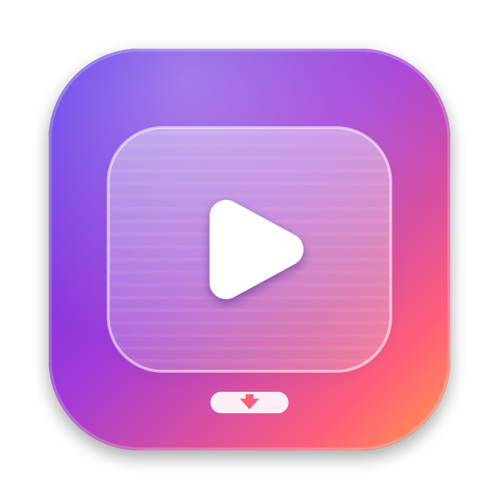

<p align="center">
  
</p>

<h1 align="center">Arrcade</h1>

<p align="center">
  A native macOS control center for your home media stack —<br>
  <b>Radarr · Sonarr · Seerr · Prowlarr · qBittorrent</b><br>
  built with SwiftUI and Liquid Glass.
</p>

<p align="center">
  
  
  
</p>

---

## Features

**Dashboard** — live transfer speeds with a graph, health warnings from every service, the Radarr/Sonarr download queue, the week's upcoming releases, pending requests, disk space and indexer stats. Cards can be shown, hidden and reset.

**Movies (Radarr)** — poster grid or sortable table, filters (missing, upcoming, cutoff unmet…), detail pages with backdrop, ratings, media info and history. Automatic and interactive search with release grabbing, monitor toggle, edit (profile, availability, path, tags), refresh, rename, delete file / movie, add movies with every option.

**Series (Sonarr)** — same library views, seasons and episodes with per-season and per-episode monitoring, season or episode search (automatic or interactive), episode details with file info and history, edit, add with monitor options.

**Seerr** — Discover carousels and search, media pages with cast, trailer and recommendations, requests with season selection, 4K, server, profile and root folder, a request list with approve / decline / retry / delete, and issues with comments, resolve and reopen.

**Torrents (qBittorrent)** — incremental sync for low-overhead live updates, a customizable 21-column table, status/category/tag/tracker filters, an inspector (general, files with priorities, trackers, peers), every torrent action (pause, force start, recheck, reannounce, location, rename, category, tags, speed and share limits, queue, sequential…), adding by magnet, URL, file or drag & drop, global and alternative speed limits, category management. Arrcade can be your default `magnet:` handler and opens `.torrent` files.

**Search (Prowlarr)** — search every indexer at once, filter by type and indexer, grab through Prowlarr or send straight to qBittorrent. Indexer management with stats, enable/disable, priority, testing and app sync.

**Calendar, Activity, System** — agenda and month calendar, combined queue / history / wanted lists, service status, health, disks, scheduled tasks (run now), logs and restart.

**Mac-native extras** — menu bar extra with live speeds and quick controls, download-complete notifications, keyboard shortcuts (⌘1–9, ⌘R, ⌘O, ⇧⌘L), customizable sidebar, fallback URLs and custom headers per server, and import of an existing **nzb360** backup.

## Install

1. Download `Arrcade.zip` from the [latest release](../../releases/latest) and move **Arrcade.app** to `/Applications`.
2. The app is not notarized, so remove the quarantine flag once:
   ```bash
   xattr -dr com.apple.quarantine /Applications/Arrcade.app
   ```
3. On first launch, click **Allow** when macOS asks for **Local Network** access — otherwise Arrcade can't reach your servers.

Requires macOS 26 (Tahoe) or later.

## Setup

Open **Settings › Servers** and either:

- click **Import nzb360 Backup…** and choose the folder containing your nzb360 backup files, or
- enter each server's URL and API key (qBittorrent uses username/password, or nothing if your LAN bypasses auth).

Use **Test** to check each connection. Every server can also have a fallback URL (e.g. a reverse proxy used when you're away), custom headers, a timeout and a self-signed-certificate option.

Settings live in `~/Library/Application Support/Arrcade/services.json`, readable only by your user.

## Build from source

```bash
brew install xcodegen
xcodegen generate
xcodebuild -project Arrcade.xcodeproj -scheme Arrcade -configuration Release -derivedDataPath build build
open build/Build/Products/Release/Arrcade.app
```

Requires Xcode 26 or later.

## Project layout

| Path | Contents |
| --- | --- |
| `ArrcadeKit/` | Swift package: networking, models, API clients for all five services, nzb360 backup importer, integration tests |
| `App/` | SwiftUI app |
| `Scripts/make-icon.swift` | Renders the app icon |
| `project.yml` | XcodeGen project spec |

## Tests

The integration tests run against real servers and undo every change they make. Point them at an nzb360 backup; without one they're skipped.

```bash
cd ArrcadeKit
ARRCADE_BACKUP=/path/to/nzb360_backup swift test
```

## Acknowledgements

Inspired by the nzb360 Android app. Arrcade is an independent project and is not affiliated with nzb360, Radarr, Sonarr, Prowlarr, Seerr or qBittorrent.

## License

[MIT](LICENSE)
